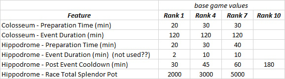
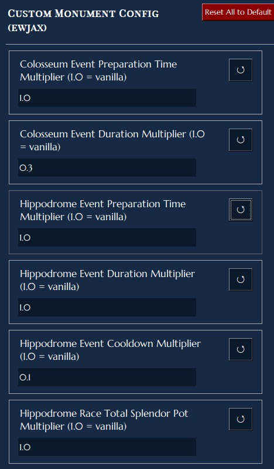

# Custom Monument Configuration

This mod gives the user the ability to adjust various parameters used in the Anno 117 monuments (Colosseum and Hippodrome), as well as Honoured Guest parameters.

Vanilla Values are as shown:

This mod gives the user the ability to adjust all these values, by use of a multiplier value.  This is most easily accomplished using the "Taludas Anno 117 Mod Manager" tweaking feature.

Example:  The default Colosseum event duration is 120 minutes.  Setting the "Colosseum Event Duration Multiplier" value to 0.2 would result in an adjusted duration of 24 minutes, since (120)*(0.2) = 24.

